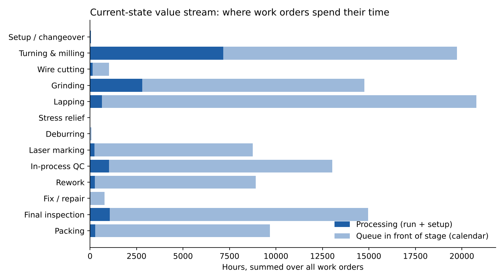
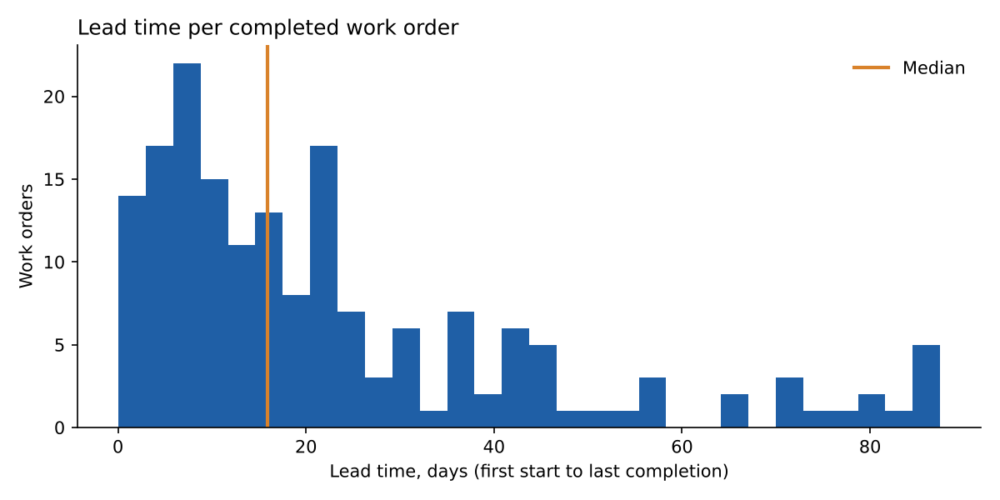
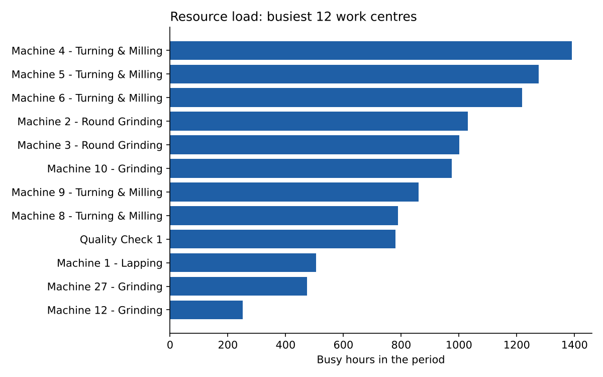
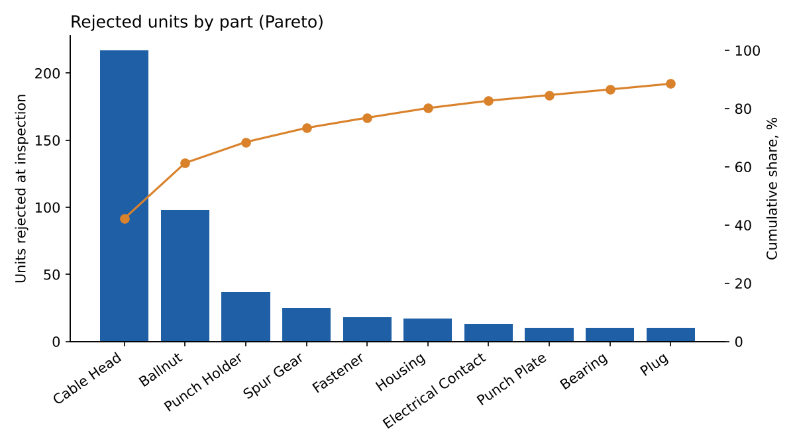
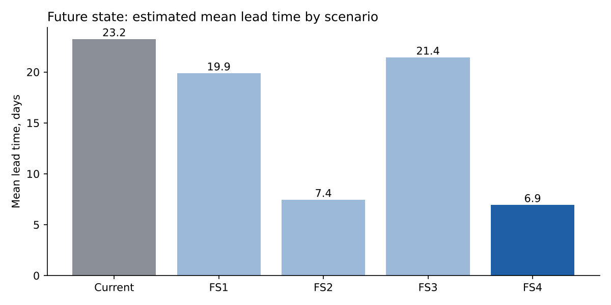
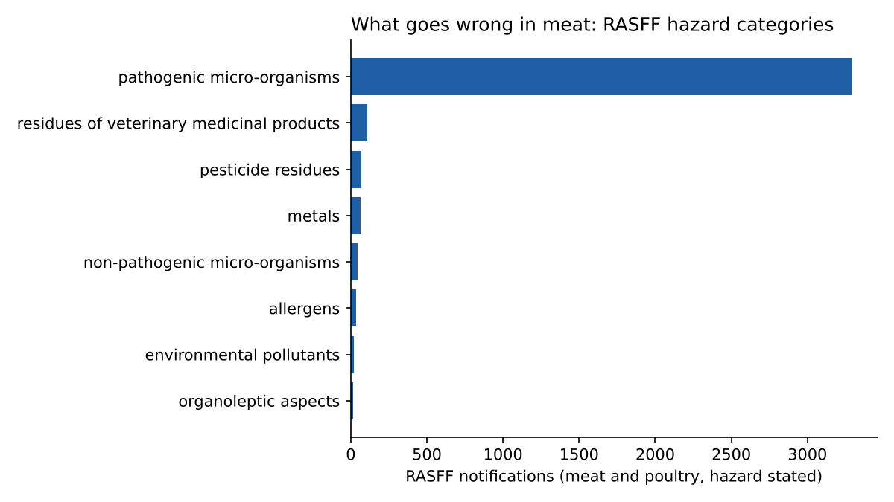
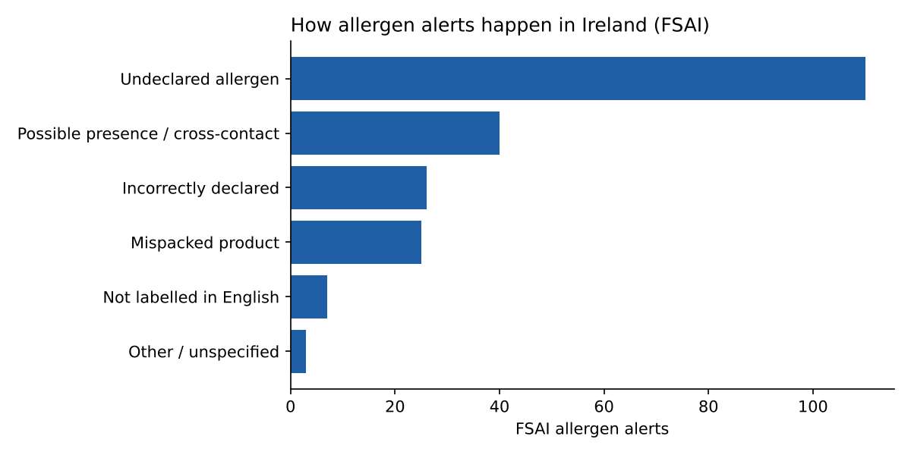

# OpsFlow-OEIS

**A production-centred Operational Excellence Information System (OEIS) prototype for a growing food manufacturer, built on real public data.**

OpsFlow-OEIS shows how a meat processing and smokehouse business could map its production flow, find the bottleneck, design a better future state, and build a food-safety-ready information system that staff keep improving after the project ends. It covers value-stream mapping, a future-state design, a food-safety and allergen risk profile, a requirements pack, a working dashboard, a user acceptance testing (UAT) pack and a sustainment kit (5S, standard work, training, daily board).

> **Honest scope.** No meat processor publishes its batch records. The production analysis therefore runs on a **real factory event log** from a different industry (a precision-parts manufacturer, 4TU.ResearchData). The methods (value-stream mapping, queue analysis, conformance, trace back / forward) transfer directly; the domain does not. The food-safety module uses **real meat and poultry data**: 4,410 EU RASFF notifications and 211 Food Safety Authority of Ireland allergen alerts. See [Limitations](#limitations).

Every number in this README is rendered from [`outputs/audit/audit.json`](outputs/audit/audit.json), which the pipeline writes as it runs. The pipeline runs 23 reconciliation checks and fails if any one fails (23/23 passed on the last run).

---

## Headline findings

**1. Work orders spend 89.2% of their lead time waiting.** Across 175 completed work orders, the median lead time is 15.9 days, but the median order is actually being worked on for only 34.9 hours. Median flow efficiency is 10.2%. Waiting is measured in calendar time because the log has no shift calendar, so nights and weekends are included.

**2. The constraint is the queue in front of Lapping.** Lapping holds 20.4% of all queue time, the largest share of any stage (next: Final inspection, 14.1%). Most orders pass straight through (median wait 0.5 h), but one visit in ten waits 268.4 h or more. Yet Machine 1 - Lapping is busy only 23.6% of calendar time, against 64.9% for Machine 4 - Turning & Milling. Long, occasional waits on a machine with spare capacity point to batching and release rules in front of Lapping, not a lack of capacity.

**3. Rework and breakdowns stretch lead time.** 53 of 225 work orders (23.6%) include rework. The 46 completed orders with rework have a median lead time of 37.1 days, against 12.3 days for completed orders without. The 53 breakdown reports hit 37 orders; the 33 completed ones have a median lead time of 22.0 days, against 15.0 days. Setup (report type S) takes 17.7% of machine time.

**4. Defects are concentrated.** 514 units were rejected at inspection (1.8% of inspected units). Cable Head alone accounts for 42.2%, and 6 parts account for 80%.

**5. Standard routes are rarely followed.** Completed orders follow 120 different stage routes. For the 5 parts with at least five completed orders, only 18.3% follow their part's most common route. Standard work and a defined routing in the OEIS are the fix.

**6. Future state: a 24-hour queue limit at the constraint, level flow and right-first-time cut estimated median lead time from 15.9 to 5.6 days.** Each lever is quantified separately below.

**7. In meat, the food-safety risk is microbiological.** Pathogens make up 88.3% of RASFF meat and poultry notifications with a stated hazard. Salmonella (all serotypes) leads (73.8%). In processed and ready-to-eat products, Listeria monocytogenes rises to 25.3%. 216 notifications involve Ireland as notifier, origin or distribution country.

**8. Allergen alerts in Ireland are mostly labelling and packing failures, the kind an OEIS label check is built to stop.** 168 of 211 FSAI allergen alerts fall into these groups: 110 undeclared allergens, 26 incorrectly declared, 25 mispacked products and 7 not labelled in English. A further 40 concern possible cross-contact. Milk (48) and Peanuts (42) are the most frequent allergens. 22 alerts concern meat products.



---

## 1. Data and data quality

| Source | What it is | Rows |
|---|---|---|
| Levy (2014), *Production Analysis with Process Mining Technology*, 4TU.ResearchData | Real production reports exported from a manufacturer's ERP/MES: work order, operation, machine, operator, start and end times, quantities completed and rejected, rework flag | 4,543 |
| EU RASFF Window, public search export | Every meat and poultry notification available (2017-02-01 to 2026-11-16) | 4,410 |
| FSAI allergen alerts listing | Every allergen alert headline on fsai.ie, collected on 17 November 2026 | 211 |

The 4TU archive is checked against the MD5 published on the dataset page before anything runs. Data lands in DuckDB as bronze, silver and gold tables.

**Production data-quality rules:** 22 exact duplicate rows were quarantined, leaving 4,521 reports on 225 work orders, 43 parts, 31 work centres and 49 operators between 2012-01-02 and 2012-03-31. The logged duration field disagrees with the timestamps in 699 rows, so timestamps are used. Report type B marks breakdowns (the dataset's own presentation shows the same breakdown events). Report type S is treated as setup, because those reports complete a mean of 0.7 units against 24.4 for type D. That reading is an inference and is labelled as one.

## 2. Value-stream baseline (current state)

| Metric | Value |
|---|---|
| Completed work orders (reached Packing) | 175 of 225 |
| Median lead time | 15.9 days (90th percentile 55.3 days) |
| Median processing time | 34.9 hours |
| Median flow efficiency | 10.2% |
| Share of lead time spent waiting | 89.2% |
| Largest queue (constraint) | Lapping, 20.4% of all queue time |
| Busiest work centre | Machine 4 - Turning & Milling, 1,390.0 busy hours (64.9% of calendar time) |
| Setup share of machine time | 17.7% |
| Most frequent hand-off | Turning & milling > In-process QC (349 times) |

Processing time is the union of a work order's busy intervals, so overlapping reports are not double counted. The queue in front of each operation is the gap since the order's latest completion; these gaps add up exactly to lead time minus processing time (checked in the pipeline).





## 3. Future-state design

| Scenario | Lever | Median lead (days) | Mean lead (days) | Flow efficiency |
|---|---|---|---|---|
| Current | Measured | 15.9 | 23.2 | 10.8% |
| FS1 | 24-hour queue limit in front of Lapping (pull signal / kanban) | 13.4 | 19.9 | 12.6% |
| FS2 | Level flow: FIFO lanes and WIP limits trim each stage's worst-quarter queues | 5.8 | 7.4 | 33.6% |
| FS3 | Right first time: rework and fix loops removed | 15.2 | 21.4 | 11.5% |
| FS4 | FS1 + FS2 + FS3 | 5.6 | 6.9 | 35.5% |

Halving setup time (SMED) would free about 1,211.0 machine hours over the period, 151.0 of them on Machine 4 - Turning & Milling. That is capacity, not lead time, so it is reported separately. These scenarios are what-if estimates from the measured queue distributions, not a capacity simulation: they assume freed time is not absorbed somewhere else.



## 4. Food-safety and allergen risk profile

| Metric | Value |
|---|---|
| RASFF meat and poultry notifications | 4,410 (2,934 poultry, 1,476 other meat) |
| Notifications per full year, 2020 to 2025 | 518 to 645 (790 in 2026 to 16 November) |
| Pathogens' share (hazard stated) | 88.3% |
| Listeria monocytogenes notifications | 301 |
| Listeria share in meat other than poultry | 20.2% |
| Listeria share in processed / ready-to-eat subjects | 25.3% of 553 |
| Risk decision "serious" | 57.6% |
| Involving Ireland | 216 (65 notified by Ireland) |
| FSAI allergen alerts: label or pack errors (mispacked, incorrectly declared, not in English) | 58 of 211 |

Each RASFF hazard category is mapped to the control point the OEIS must record (for example, pathogens map to cook / smoke and chill CCP records, environmental Listeria monitoring and positive release; allergens map to recipe allergen profiles, changeover sign-off and label verification). All 26 categories are mapped: see [`outputs/tables/rasff_hazard_categories_controls.csv`](outputs/tables/rasff_hazard_categories_controls.csv).




## 5. Traceability demonstration

The completed work order with the most units rejected at final inspection is **Case 18** (Cable Head, 24 units rejected).

- **Trace back:** 172 upstream reports across 9 work centres and 16 operators.
- **Trace forward:** its last machining step ran on Machine 2 - Round Grinding. Within 24 hours either side, 4 other work orders (2 parts, 447 units ordered) used the same machine, and 4 of them had already reached Packing.
- The whole trace runs in under a second (timed on every run, see `audit.json`). On paper records, this is the step that takes hours in a mock recall.

In a smokehouse the same joins run on raw-material lot → batch → pack → customer ([requirements pack, section 7](docs/OEIS_Requirements.md)).

## 6. Deliverables

| Deliverable | Where |
|---|---|
| Data layer with data-quality rules and quarantine | `src/opsflow/step1_data_layer.py`, `outputs/tables/dq_results_production.csv` |
| Current-state value stream | `src/opsflow/step2_value_stream.py`, `outputs/tables/stages.csv` |
| Future-state design | `src/opsflow/step3_future_state.py`, `outputs/tables/future_state_scenarios.csv` |
| Food-safety and allergen risk profile | `src/opsflow/step4_food_safety.py` |
| Traceability demonstration | `src/opsflow/step5_traceability.py` |
| OEIS requirements pack (BRD / FRD, data model, KPI dictionary, integrations, traceability matrix) | [`docs/OEIS_Requirements.md`](docs/OEIS_Requirements.md) |
| UAT pack (15 test cases, entry / exit criteria, defect log) | [`docs/UAT_Pack.md`](docs/UAT_Pack.md) |
| Sustainment kit: 5S audit, standard work / SOP template, training and adoption plan, daily tier meeting board | [`docs/sustainment/`](docs/sustainment/) |
| Interactive dashboard (Streamlit) | `app/streamlit_app.py` |
| Excel KPI pack (formula-driven, part filter, daily board) | `outputs/excel/OpsFlow_OEIS_KPI_Pack.xlsx` |
| Power BI star schema, 22 DAX measures and build guide | `powerbi/` |
| Methodology | [`docs/methodology.md`](docs/methodology.md) |

## 7. Run it

```bash
pip install -r requirements.txt
# put the 4TU archive in data/raw/ (see data/README.md), then:
python run_pipeline.py          # builds everything and runs 23 checks
pytest -q                       # tests
streamlit run app/streamlit_app.py
```

## Limitations

- **Industry transfer.** The production log is from a precision-parts manufacturer, not a meat plant. Stage names, routes and rejection rates are that factory's, not a smokehouse's. The analysis demonstrates the method an OEIS would run on a smokehouse's own records.
- **Calendar time.** Without a shift calendar, waiting time includes nights and weekends. Relative comparisons between stages and scenarios are sound; absolute waiting hours overstate working-time waits.
- **Observation window.** The log covers about 89.2 days. Orders started before or finished after the window are partly observed, so lead-time and conformance figures use completed orders only.
- **Report-type S** is interpreted as setup from the quantity pattern; the dataset documentation does not define it.
- **Future state** figures are estimates from measured distributions, not a simulation.
- **RASFF** counts are notifications, not incidence. Reporting varies by country and over time, and Window exports omit company names.
- **FSAI** alert classification uses the alert headline only; 3 headlines did not state a failure mode clearly.

## Data licences and credits

- Production log: Dafna Levy (2014), 4TU.ResearchData, under the 4TU General Terms of Use. It is not redistributed here; `data/README.md` explains how to download it.
- RASFF: European Commission, RASFF Window. Reuse with acknowledgement under the Commission's reuse policy.
- FSAI: alert headlines and links from fsai.ie, used for analysis with attribution.
- Code: MIT licence.

*Independent portfolio project by Sohum Vivek Dhole ([github.com/sohumdhole](https://github.com/sohumdhole)).*
