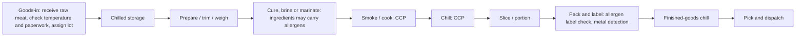

# OEIS Requirements Pack: Production-Centred Operational Excellence Information System

**Document type:** Business and functional requirements (BRD / FRD), data model, integration, KPI dictionary and requirements traceability matrix.
**Context:** a growing meat processing and smokehouse business that supplies retail, foodservice and wholesale customers and needs to scale production without a matching rise in manual administration.
**Status:** reference design produced as an independent portfolio project. It is not based on any company's internal documents. Process steps for a smokehouse are described generically; all critical limits are those set in the operating site's own HACCP plan.

Evidence for the baseline figures quoted here comes from the analysis in this repository (see `README.md` and `outputs/audit/audit.json`).

---

## 1. Business objectives

| ID | Objective | How the OEIS supports it | Measured by |
|---|---|---|---|
| BO-1 | Scale output without a proportional rise in administration | Replace paper batch sheets and spreadsheets with one capture point per task | Admin hours per 1,000 kg produced |
| BO-2 | Improve flow, capacity utilisation and yield | Real-time visibility of WIP, waiting time, bottlenecks, yield and scrap | Lead time, throughput, yield %, OEE |
| BO-3 | Protect food safety, allergen control and traceability | CCP, allergen changeover and lot genealogy captured at source | Mock recall time and completeness, CCP record completeness |
| BO-4 | Be audit-ready for customers and certification schemes | Records time-stamped, attributable, versioned and exportable | Audit findings related to records |
| BO-5 | Build a continuous-improvement culture that lasts after the project | Daily board, 5S audits, improvement log fed from OEIS data | Ideas logged and closed per month |

## 2. Scope

**In scope:** goods-in and raw-material lots; production orders and batches; process steps (prepare, cure or marinate, smoke or cook, chill, slice, pack, label); yield and scrap capture; CCP and allergen changeover records; WIP and finished-goods stock; dispatch to customer; KPI dashboards; daily board; document and training registers.
**Out of scope for phase 1:** finance and payroll; full warehouse management; customer EDI beyond order import (listed as a later integration).

## 3. Users and roles

| Role | Main tasks in the OEIS | Device |
|---|---|---|
| Operator | Start / finish tasks, record weights, checks and lot numbers, raise problems | Wash-down tablet or terminal at the workstation, barcode scanner |
| Team leader | Plan the shift, approve batch records, run the daily board, 5S audits | Tablet, board screen |
| Quality / technical | CCP and allergen review, holds and releases, mock recalls, audit exports | PC |
| Production / operations manager | Capacity plan, KPI review, targets, improvement log | PC, board screen |
| Goods-in / dispatch | Receive and label raw material, dispatch orders against lots | Scanner, label printer |
| Super-user / admin | Master data, user access, report changes | PC |

## 4. Current-state process (generic smokehouse)

**Typical pain points the analysis looks for** (quantified on a real production log in `README.md`, section "Value-stream baseline"): waiting between steps that is far longer than processing time; rework loops; a single resource whose queue sets the pace for everything; batching rules that hold finished work; and data recorded late or twice.

## 5. Functional requirements

Priority uses MoSCoW (M = must, S = should, C = could).

### 5.1 Production capture
| ID | Requirement | Priority |
|---|---|---|
| FR-01 | The system shall let an operator start and finish a task against a production order and batch, recording time-stamps automatically. | M |
| FR-02 | The system shall record input weight, output weight, rework and scrap quantity for every yield-relevant step and calculate yield % on save. | M |
| FR-03 | The system shall record the operator and workstation / equipment for every task. | M |
| FR-04 | The system shall show the next scheduled task per workstation and the current WIP queue in front of it. | S |
| FR-05 | The system shall let a team leader record downtime with a reason code. | S |

### 5.2 Food safety, allergens and quality
| ID | Requirement | Priority |
|---|---|---|
| FR-06 | The system shall record every CCP check (value, limit, pass / fail, who, when) and block batch release while a CCP check is missing or failed without a recorded corrective action. | M |
| FR-07 | The system shall hold the allergen profile of every ingredient and product and warn when a product containing an allergen is scheduled on a line before an allergen-free product without a changeover step. | M |
| FR-08 | The system shall require a signed allergen changeover / clean verification record before the next product starts on a shared line. | M |
| FR-09 | The system shall verify that the printed label (product, allergens, batch, date) matches the batch being packed. | M |
| FR-10 | The system shall support placing a batch or lot on hold and releasing it, with reason and approver. | M |

### 5.3 Traceability
| ID | Requirement | Priority |
|---|---|---|
| FR-11 | The system shall link every raw-material lot to the batches that consumed it and every batch to the packs and customer dispatches it produced (lot genealogy). | M |
| FR-12 | The system shall produce a one-step-back / one-step-forward trace report for any lot, batch, equipment item or operator and time window. | M |
| FR-13 | The system shall record mock-recall exercises (start, finish, completeness %). | S |

### 5.4 Planning, KPIs and improvement
| ID | Requirement | Priority |
|---|---|---|
| FR-14 | The system shall calculate the KPIs in section 8 from captured records without manual re-keying. | M |
| FR-15 | The system shall show a daily board page (SQDCP) refreshed before each shift. | M |
| FR-16 | The system shall show a value-stream view: processing time, waiting time and WIP per step for a chosen period. | S |
| FR-17 | The system shall hold 5S audit scores and an improvement-ideas log with owner, status and benefit. | S |
| FR-18 | The system shall flag process variants that skip or repeat steps (conformance) for review. | C |

### 5.5 Data quality and administration
| ID | Requirement | Priority |
|---|---|---|
| FR-19 | The system shall validate entries at capture (mandatory fields, ranges, valid lot numbers, completion after start). | M |
| FR-20 | The system shall keep an audit trail of every create / change / delete with user and time. | M |
| FR-21 | The system shall run scheduled data-quality checks and list exceptions for a named owner. | S |
| FR-22 | The system shall control master data (products, recipes, allergens, equipment, users) through a single admin function. | M |

## 6. Non-functional requirements
| ID | Requirement |
|---|---|
| NFR-01 | Usable at a wash-down workstation with gloves: large touch targets, scan-first entry, no free typing for routine steps. |
| NFR-02 | A routine record (start, finish, weight) takes no more than a few seconds and three taps. |
| NFR-03 | Records are time-stamped by the system clock, attributable to a named user and cannot be edited without an audit trail entry. |
| NFR-04 | Works through short network drops on the floor (local caching with later sync). |
| NFR-05 | Role-based access; operators cannot release holds or change master data. |
| NFR-06 | Daily backup; restore tested at least once before go-live. |
| NFR-07 | Data retention meets the longest period required by customers, certification schemes and food law. |

## 7. Data model

Star-schema view used for reporting (see `powerbi/` for the implemented version on the real data).

| ID | Entity | Grain | Key fields |
|---|---|---|---|
| DE-01 | `dim_product` | One row per product / part | product_id, description, allergen profile, standard yield |
| DE-02 | `dim_resource` | One row per workstation / machine | resource_id, area, capacity |
| DE-03 | `dim_operator` | One row per operator | operator_id, role, training status |
| DE-04 | `dim_date` | One row per day | date, week, month, shift calendar |
| DE-05 | `fact_task` | One row per task performed on a batch | batch_id, step, resource_id, operator_id, start, finish, qty_in, qty_good, qty_rejected, rework_flag |
| DE-06 | `fact_batch` | One row per batch / production order | batch_id, product_id, order qty, release status, lead time |
| DE-07 | `bridge_lot_genealogy` | One row per lot consumed by a batch, and per batch shipped to a customer | parent_lot, child_lot / batch, qty |
| DE-08 | `fact_ccp_check` | One row per CCP check | batch_id, ccp, value, limit, result, corrective_action |
| DE-09 | `fact_5s_audit` | One row per audit item | area, date, item, score |
| DE-10 | `doc_register` | One row per SOP version | sop_id, version, owner, review date |

**Traceability join path.** Raw-material lot → `bridge_lot_genealogy` → batch → `fact_task` (resource, operator, time) → pack lot → dispatch. Section 6 of `README.md` demonstrates the batch → resource / operator / time-window part of this path on real data.

## 8. KPI dictionary

| KPI | Definition | Formula | Source | Direction |
|---|---|---|---|---|
| Throughput | Good units completed per period | Σ qty_good | fact_task | Higher |
| Lead time | Order release to completion of last step | max(finish) - min(start) per batch | fact_task | Lower |
| Processing time | Time a batch is actually being worked on | Σ (finish - start) per batch | fact_task | n/a |
| Waiting time | Time a batch sits between steps | lead time - processing time (non-overlapping) | fact_task | Lower |
| Flow efficiency | Share of lead time that adds value | processing time / lead time | fact_task | Higher |
| First pass yield | Share of units good first time | qty_good / (qty_good + qty_rejected) | fact_task | Higher |
| Rejection rate | Share of units rejected | qty_rejected / (qty_good + qty_rejected) | fact_task | Lower |
| Rework rate | Share of batches with a repeated step | batches with rework / all batches | fact_task | Lower |
| Resource utilisation | Busy time / available time per resource | Σ task time / shift time | fact_task, dim_resource | Balanced |
| Conformance | Share of batches following the standard route | conforming batches / all batches | fact_task | Higher |
| OEE | Availability x performance x quality | standard formula once downtime and rate are captured (FR-05) | fact_task, downtime | Higher |
| CCP record completeness | Share of required CCP checks recorded on time | recorded / required | fact_ccp_check | 100% |
| Mock recall time | Time to trace one lot back and forward | finish - start | mock recall record | Lower |
| 5S score | Audit score | total / max x 100 | fact_5s_audit | Higher |

## 9. Integrations
| ID | System | Direction | Data | Priority |
|---|---|---|---|---|
| INT-01 | Weighing scales | In | Gross / net weights against task | M |
| INT-02 | Label printers | Out | Product, allergens, batch, use-by, barcode | M |
| INT-03 | Accounts / ERP | Both | Customer orders in, dispatched quantities out | S |
| INT-04 | Temperature monitoring | In | Chill and smoke chamber readings for CCP evidence | S |
| INT-05 | Customer portals / EDI | In | Orders and forecasts | C |

## 10. Requirements traceability matrix

| Req | Objective | Evidence in this repo | Test case (UAT_Pack.md) |
|---|---|---|---|
| FR-01, FR-03 | BO-2 | Step 1 data layer: tasks with start / finish / resource / operator | UAT-01 |
| FR-02 | BO-2 | Step 2: yield and rejection by step and part | UAT-02 |
| FR-06 | BO-3 | Step 4: hazard profile defines CCP evidence needs | UAT-05 |
| FR-07, FR-08, FR-09 | BO-3 | Step 4: FSAI allergen alert causes (mispacking, undeclared allergens) | UAT-06, UAT-07 |
| FR-10 | BO-3 | Hold / release workflow | UAT-08 |
| FR-11, FR-12 | BO-3, BO-4 | Step 5: trace back / forward on real production data | UAT-09 |
| FR-14, FR-15 | BO-1, BO-2 | Streamlit dashboard and Power BI model | UAT-10, UAT-11 |
| FR-16 | BO-2 | Step 2: value-stream baseline | UAT-12 |
| FR-17 | BO-5 | Sustainment kit (5S, daily board) | UAT-13 |
| FR-18 | BO-2 | Step 2: conformance to standard route | UAT-14 |
| FR-19, FR-21 | BO-4 | Data-quality rules and quarantine | UAT-03, UAT-04 |
| FR-20 | BO-4 | Audit trail requirement | UAT-15 |
